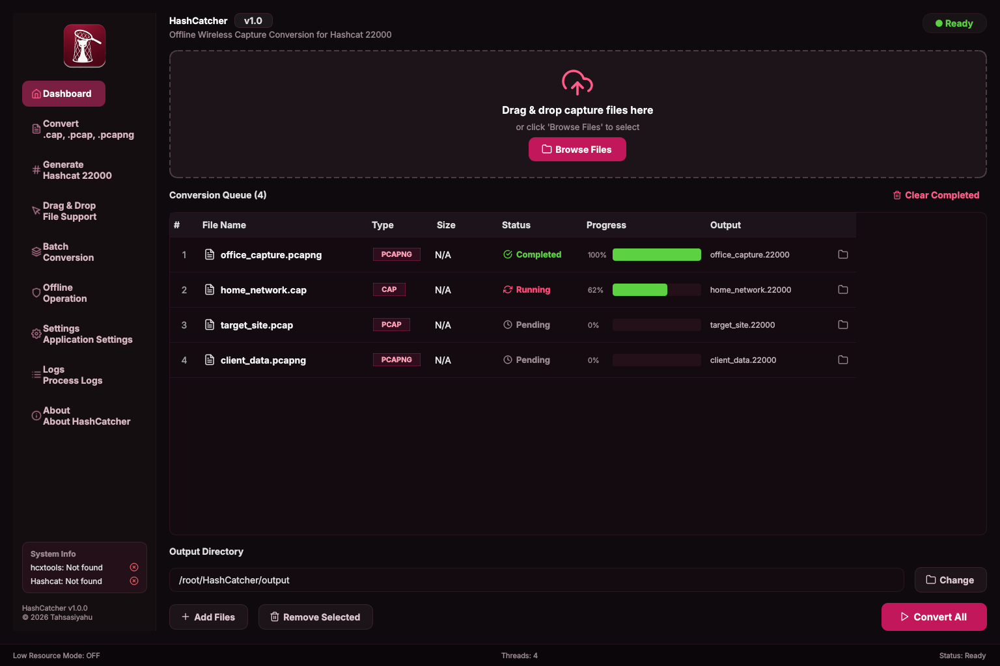

<div align="center">

# 🐾 HashCatcher

### Offline Wireless Capture → Hashcat 22000 Converter


Fast. Offline. Desktop-native. Optimized for Hashcat workflows.

</div>

---

## 📖 Overview

HashCatcher is a graphical desktop application for converting wireless capture files into Hashcat-compatible `22000` format using [`hcxtools`](https://github.com/ZerBea/hcxtools).

It's intended for:

- authorized wireless auditing
- password recovery workflows
- educational research
- penetration testing engagements

## ✨ Features

**Input formats:** `.cap`, `.pcap`, `.pcapng` → **Output format:** Hashcat `22000`

| Feature | Description |
|---|---|
| 🖱 Drag & Drop | Import captures directly into the queue |
| 📦 Batch Conversion Queue | Convert many captures in one run, with per-file progress |
| ⚡ Concurrent Conversion | Up to N files converted in parallel (configurable thread count) |
| 🌙 Low Resource Mode | Drops to single-threaded conversion for laptops & VMs |
| 📂 Custom Output Directory | Choose where `.22000` files are written |
| 🛠 Configurable `hcxpcapngtool` Path | Point at a non-PATH install from Settings |
| 📊 Live System Info | Detects installed hcxtools / Hashcat versions |
| 🔒 Offline Operation | No network access required |
| 🌐 Cross Platform | Linux / Windows / macOS |

## 🖼 Interface Preview

<div align="center">



</div>

## 🖥 Supported Platforms

| Platform | Package |
|---|---|
| 🐧 Linux | `.deb`, AppImage, Flatpak |
| 🪟 Windows | `.exe` |
| 🍎 macOS | `.dmg` |

## 📦 Prebuilt Packages

Prebuilt packages are published in [GitHub Releases](https://github.com/Tzaphiel/HashCatcher/releases):
Debian Package (`.deb`), AppImage, Flatpak, Windows Installer (`.exe`), macOS Disk Image (`.dmg`).

## ⚙ Installation

### Debian / Ubuntu

```bash
sudo dpkg -i hashcatcher_1.0.0.deb
sudo apt -f install   # fix dependencies if required
hashcatcher           # or: Applications → Utilities → HashCatcher
```

### AppImage

```bash
chmod +x HashCatcher.AppImage
./HashCatcher.AppImage
```

### Flatpak

```bash
sudo apt install flatpak
flatpak install hashcatcher.flatpak
flatpak run io.hashcatcher.HashCatcher
```

### Windows

Run `HashCatcher_Setup.exe` and follow the installer. If SmartScreen appears, click **More Info → Run Anyway**. Launch from the Start Menu afterward.

### macOS

Open `HashCatcher.dmg`, drag `HashCatcher.app` into **Applications**, then launch it from there.

## 🧑‍💻 Build From Source

```bash
git clone https://github.com/Tzaphiel/HashCatcher.git
cd HashCatcher
```

**Install dependencies (Debian/Ubuntu):**

```bash
sudo apt update
sudo apt install -y python3 python3-pip python3-pyside6 hcxtools hashcat git
pip install -r requirements.txt
```

**Run it:**

```bash
python3 src/main.py
```

**Build a Debian package:**

```bash
chmod +x build_deb.sh
./build_deb.sh
# -> HashCatcher_1.0.0_amd64.deb
```

## 🌐 Automated Releases

Pushing a version tag triggers `.github/workflows/release.yml`, which builds Linux (`.deb`), Windows (`.exe`) and macOS packages and publishes them as a GitHub Release:

```bash
git tag v1.0.0
git push origin v1.0.0
```

Download the result from the repo's **Releases** page or the workflow's **Actions → Artifacts**.

## 📂 Output

Converted files are written next to the source capture by default (`capture.pcapng` → `capture.22000`), or to a custom folder set in **Settings → Output directory**.

## 🔧 Troubleshooting

| Error | Fix |
|---|---|
| `src refspec main does not match any` | `git add . && git commit -m "Initial release" && git branch -M main && git push -u origin main` |
| `Authentication failed` (git push) | GitHub no longer accepts password auth. Create a [Personal Access Token](https://github.com/settings/tokens) and use it in place of your password. |
| `failed to push some refs` | `git push -u origin main --force` (only if you intend to overwrite the remote branch) |
| `hcxtools not found` / `hcxpcapngtool was not found` | `sudo apt install hcxtools`, or set a custom path in **Settings** |
| `ModuleNotFoundError: PySide6` | `sudo apt install python3-pyside6` or `pip install PySide6` |
| `Permission denied` running a script | `chmod +x scriptname.sh` |
| App won't launch | Usually missing Qt dependencies or a broken install — `sudo apt install -f` then reinstall |

## ⚡ Performance

Optimized for low CPU/memory usage, background-safe execution, and large batch processing across multi-core systems — conversion runs several files concurrently (tunable in Settings, or capped to one with Low Resource Mode).

## 🔐 Security Notice

HashCatcher is intended exclusively for authorized security testing, educational environments, and legal wireless auditing. Unauthorized access to systems or credentials may violate laws and regulations.

## 📜 License

[GPL-3.0](LICENSE)

## 🙏 Credits

**Developed by:** Tahsasiyahu

**Built with:** Python, PySide6 / Qt6, [hcxtools](https://github.com/ZerBea/hcxtools), [Hashcat](https://hashcat.net/hashcat/), GitHub Actions. Nav/status icons from [Feather Icons](https://feathericons.com/) (MIT).

---

<div align="center">

### 🐾 HashCatcher — Catching Hashes Efficiently

</div>
